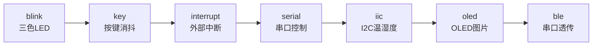
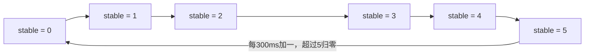
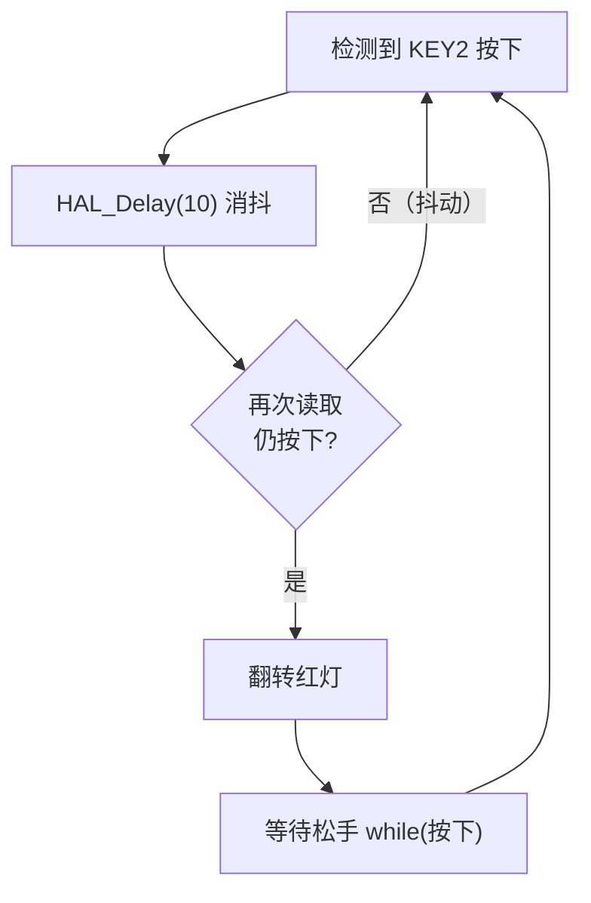
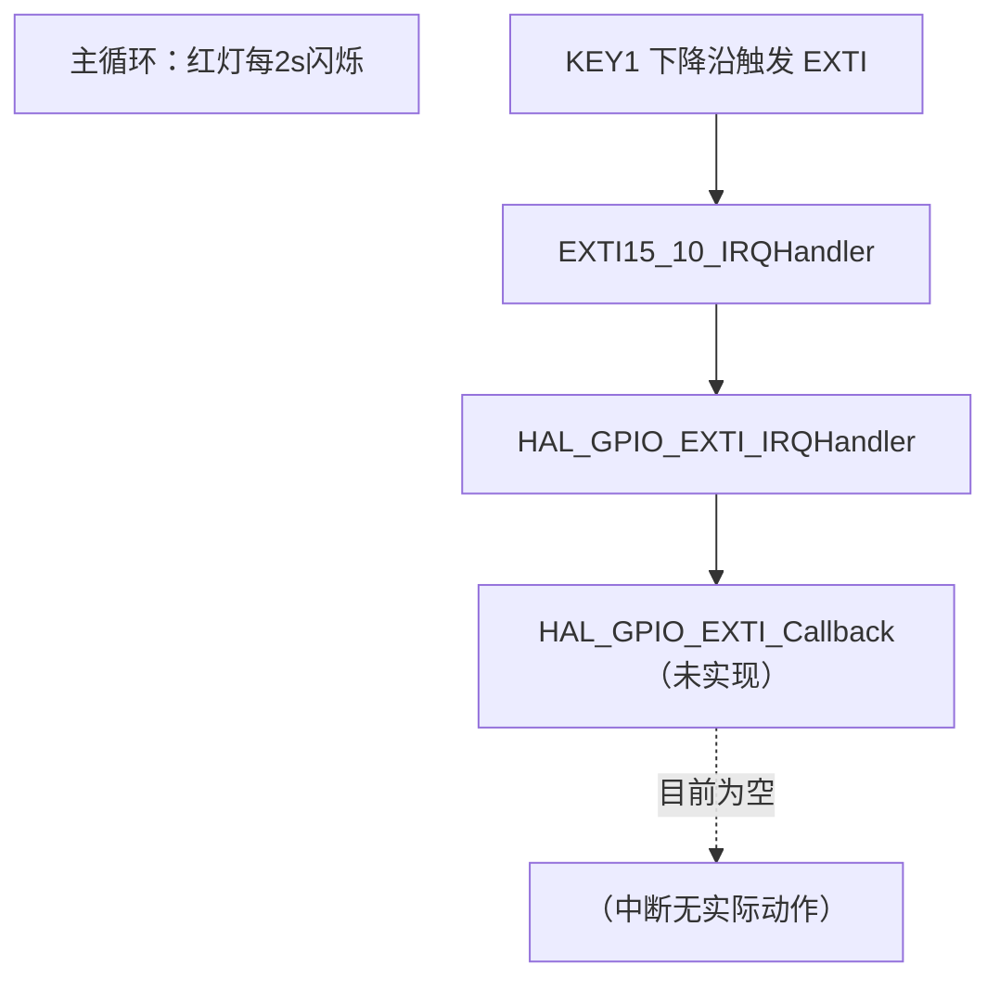
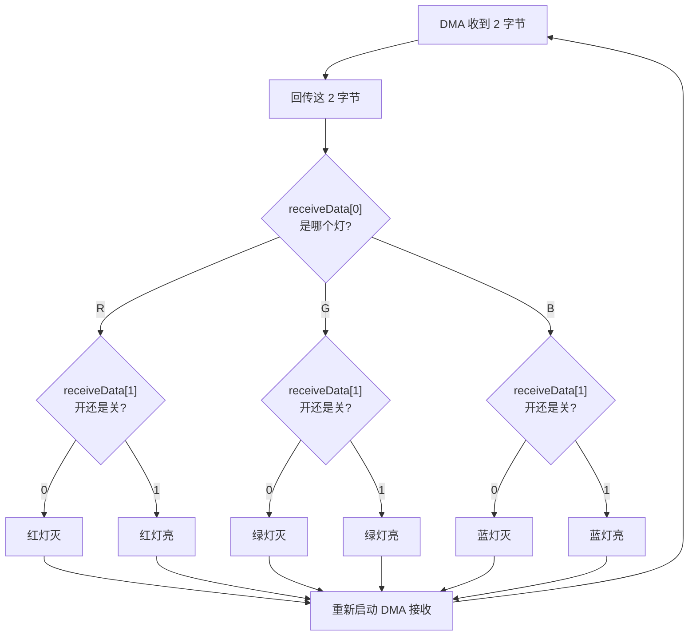
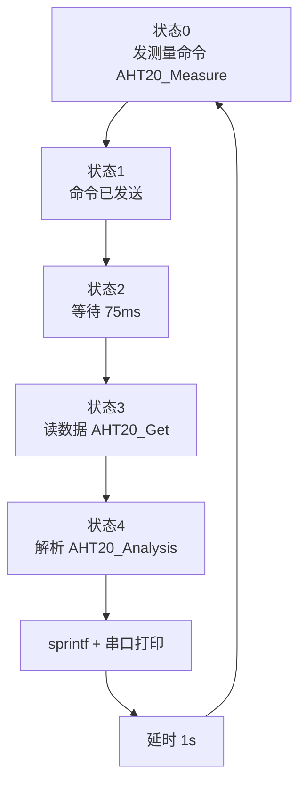
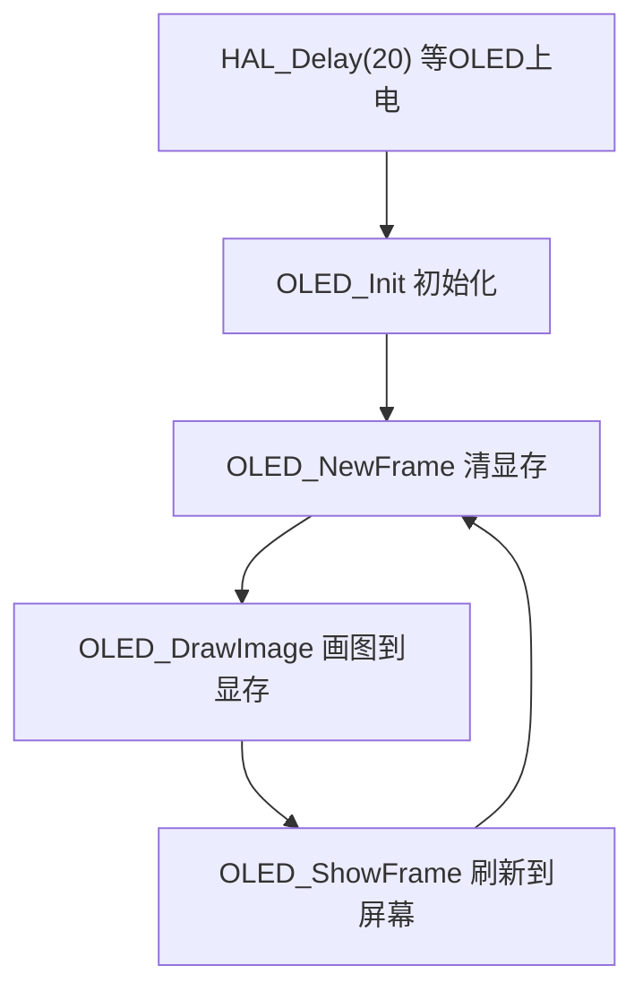
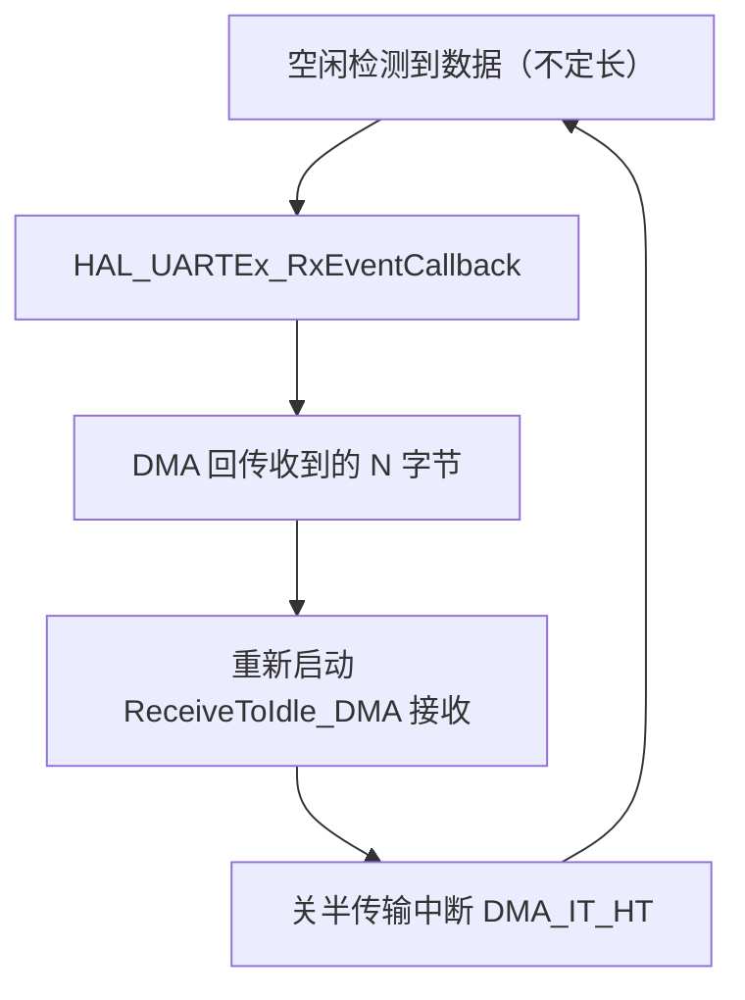

# STM32 代码笔记

> **工作区**：`D:\stm32`（STM32CubeIDE 1.19.0）
> **芯片**：STM32F103C8T6（Blue Pill）
> **开发方式**：STM32CubeMX 生成 + HAL 库
> **说明**：本笔记汇总工作区内 9 个工程的代码（不含生物工程那个项目）。
> **Mermaid 图**：本文档使用 Mermaid 流程图，在 **Obsidian / GitHub / VS Code（装 Markdown Preview Mermaid Support 插件）** 里可直接渲染。

---

## 一、工程总览

**学习脉络**：点灯 → 按键 → 中断 → 串口 → 串口 DMA → I2C 传感器 → OLED 显示 → BLE 透传，基本覆盖了 STM32 最常用的外设。



| 工程 | 功能 | 主要外设 | 系统时钟 |
|------|------|----------|----------|
| blink | 三色 LED 循环点亮 | GPIO 输出 | HSI |
| hello | 空模板（未完成） | GPIO 输出 | HSI |
| key | 按键控制 LED（含消抖） | GPIO 输入/输出 | HSI |
| interrupt | 外部中断 + LED 闪烁 | GPIO + EXTI | HSI |
| serial | 串口命令控制 RGB 灯 | USART2 + DMA | HSI |
| iic | AHT20 温湿度传感器 | I2C1 + USART2 + DMA | HSI |
| oled | OLED 显示图片 | I2C1 + OLED(CH1116) | HSE+PLL 72MHz |
| oled1 | OLED 初始化（简化版） | I2C1 + OLED(CH1116) | HSE+PLL 72MHz |
| ble | 串口透传/回显 | USART3 + DMA | HSI |

---

## 二、各工程详解

### 1. blink —— 三色 LED 循环点亮

- **功能**：用一个计数器 `stable`（0~5 循环，每 300ms 加一）控制 RGB 三色 LED 的亮灭组合，形成颜色轮换效果。



- **核心逻辑**：
  ```c
  if (stable <= 2 || stable == 5) 红灯亮，否则灭;
  if (stable >= 1 && stable <= 3) 绿灯亮，否则灭;
  if (stable >= 2)                蓝灯亮，否则灭;
  HAL_Delay(300);
  if (++stable > 5) stable = 0;
  ```
- **手写部分**：`main.c` 的 USER CODE 2 和 WHILE 区域。

### 2. hello —— 空模板

- **现状**：只初始化了 PA7 为推挽输出并置高电平，主循环为空。
- **说明**：工程名叫 hello，但还没有实现（推测原本想做串口打印 "hello"），属于未完成模板。

### 3. key —— 按键控制 LED

- **功能**：两个按键分别控制两个 LED。
- **KEY1**（无内部上拉，依赖外部电路）：
  ```c
  if (HAL_GPIO_ReadPin(KEY1) == RESET) 绿灯亮; else 绿灯灭;   // 直接读取
  ```
- **KEY2**（内部上拉 + 10ms 软件消抖）：



- **知识点**：GPIO 输入模式、上拉电阻、软件消抖、松手检测。

### 4. interrupt —— 外部中断 + LED 闪烁

- **功能**：红灯每 2s 闪烁一次；KEY1 配置为 EXTI 下降沿中断（`EXTI15_10_IRQn`，优先级 15）。



- **现状**：中断已使能、NVIC 已配置，但**没有实现 `HAL_GPIO_EXTI_Callback` 回调**，所以中断触发后目前没有实际动作。`main.c` 里被注释掉的代码是之前用轮询方式读按键的方案。
- **知识点**：EXTI 外部中断配置、NVIC 优先级、中断处理流程。

### 5. serial —— 串口命令控制 RGB 灯

- **功能**：通过 USART2 + DMA 接收 **2 字节**命令控制 RGB 灯。
- **命令格式**：`[R/G/B][0/1]`，例如 `R1` 开红灯、`G0` 关绿灯。



- **核心逻辑**（`HAL_UART_RxCpltCallback` 回调）：
  ```c
  收到 2 字节 → DMA 回传这 2 字节 → 解析:
    receiveData[0] = 'R'/'G'/'B'   // 哪个灯
    receiveData[1] = '0'/'1'       // 开还是关
  → 控制对应 LED → 重新启动 DMA 接收
  ```
- **知识点**：UART + DMA 收发、接收完成回调、简单的命令解析协议。

### 6. iic —— AHT20 温湿度传感器

- **功能**：通过 I2C1 读取 AHT20 温湿度，用 USART2 串口打印。
- **状态机**（`aht20State`，0→4 循环）：



- **手写驱动** `aht20.c / aht20.h`：
  - `AHT20_Init()`：I2C 地址 0x70，上电等待后若需校准则发 `0xBE 0x08 0x00`。
  - `AHT20_Measure()/AHT20_Get()/AHT20_Analysis()`：DMA 方式的分步测量。
  - `AHT20_Read()`：阻塞式一体函数（备用，主循环未用）。
- **数据换算**：
  ```c
  湿度 = raw * 100.0f / 2^20;
  温度 = raw * 200.0f / 2^20 - 50;
  ```
- **知识点**：I2C 主模式收发（阻塞/DMA）、传感器数据帧解析、状态机编程、浮点运算 + sprintf。

### 7. oled —— OLED 显示图片

- **功能**：OLED（CH1116 驱动，128×64，I2C 地址 0x7A）显示一张图片 `微信图片_20261026150602_122_38Img`，循环刷新。



- **集成第三方库**：波特律动 keysking 的 OLED 驱动（`oled.c/oled.h` + `font.c/font.h`，MIT 协议），提供：
  - 基础：`OLED_Init / NewFrame / ShowFrame / SetPixel`
  - 绘图：线段(Bresenham)、矩形、三角形、圆、椭圆、图片
  - 文字：ASCII（`OLED_PrintASCIIString`）、中英文混排（`OLED_PrintString`，自动识别 UTF-8）
- **知识点**：OLED 驱动原理（显存 GRAM + 页/列寻址）、图形学基础算法（Bresenham 直线/圆）、点阵字模、I2C 器件通信、第三方库移植。

### 8. oled1 —— OLED 初始化（简化版）

- **功能**：只做了 `HAL_Delay(20); OLED_Init();`，主循环为空。
- **说明**：是 oled 工程的精简/测试版，仅验证 OLED 能否初始化点亮。

### 9. ble —— 串口透传 / 回显

- **功能**：USART3 + DMA 的**不定长数据回显**（ReceiveToIdle），收到什么就原样发回，用于连接 BLE 透传模块。



- **核心逻辑**（`HAL_UARTEx_RxEventCallback` 回调）：
  ```c
  if (huart == &huart3) {
      HAL_UART_Transmit_DMA(&huart3, receiveData, Size);       // 回传
      HAL_UARTEx_ReceiveToIdle_DMA(&huart3, receiveData, 50);  // 重新接收
      __HAL_DMA_DISABLE_IT(&hdma_usart3_rx, DMA_IT_HT);        // 关半传输中断
  }
  ```
- **知识点**：DMA + 不定长接收（ReceiveToIdle）、空闲中断、DMA 半传输中断的作用与关闭。

---


```

---

